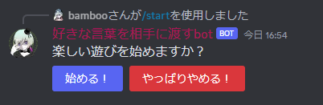
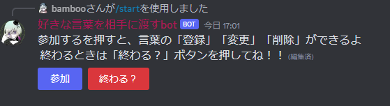
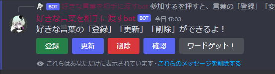
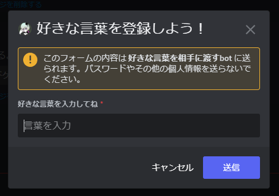
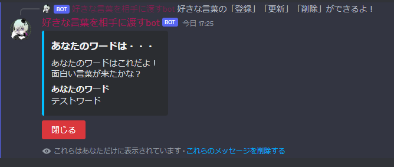

# フレーズブレンダー

Discordサーバーの参加者が好きな言葉を登録し、くじ引きのようにランダムで受け取るボットです。
言葉は利用するサーバー・チャンネルごとに管理します。

## 主な機能

- 言葉の登録・確認・更新・削除。更新・削除は確認画面から実行します。
- 参加者の登録完了後にワードを抽選し、最後に取得したワードを再確認できます。
- 登録上限や、終了時の一覧に登録者名を表示するかを設定できます。
- 問題のある言葉を登録者名がわからなくても通報できます。
- NGワードの登録・更新を拒否し、NGユーザー・NGサーバーの利用を制限します。
- 運営者向け管理画面で統計・通報情報の確認とNG設定の管理を行えます。

## 利用者向けコマンド

| コマンド | 用途 |
| --- | --- |
| `/start` | チャンネルでゲームを開始・再開します。 |
| `/help` | 使い方を表示します。 |
| `/report` | 同じチャンネルに登録された言葉を検索・選択して通報します。理由は任意です。 |

NG登録・解除は管理画面から行います。Discordの `/ng-user`、`/ng-server`、`/ng-list` は廃止しました。

### 遊び方

1. `/start` を実行し、「始める！」を押します。
2. 各参加者が「参加」から言葉を登録します。言葉は100文字以内です。
3. 登録を終えたら登録完了ボタンを押します。参加者全員の完了後にワードを取得できます。
4. 終了ボタンからゲームを終了すると、設定に応じた一覧画像を表示します。

登録済みの言葉は更新・削除できますが、取得済みの言葉は対象外です。
参加後の個別操作画面は本人だけに表示します。終了時の一覧の名前表示はゲーム設定で変更できます。

<details>
<summary>操作画面の例（過去バージョンの画像を含みます）</summary>







</details>

## Linux Dockerでの導入

Python 3.14.8、discord.py 2.7.1、MySQL 8.4を使用します。
Pythonの依存バージョンは [requirements.txt](requirements.txt)、イメージの構成は [Dockerfile](Dockerfile) を参照してください。

前提はDocker Engine、Docker Compose v2以降、Discordボットのトークンです。
Discord Developer PortalではServer Members IntentとMessage Content Intentを有効にし、
対象サーバーに `bot` と `applications.commands` のスコープで招待してください。

```sh
cp .env.linux.example .env.linux
chmod 600 .env.linux
# .env.linuxのBOT_TOKEN、PASS、MYSQL_ROOT_PASSWORDなどを設定する

docker compose --env-file .env.linux -f docker-compose.linux.yml config --quiet
docker compose --env-file .env.linux -f docker-compose.linux.yml up -d --build
docker compose --env-file .env.linux -f docker-compose.linux.yml ps
```

DBは初回に [初期化SQL](docker/mysql/init.sql) で作成し、DBの準備完了後にボットを起動します。
既存DBでは初期化SQLが再実行されないため、バックアップ後に必要な [マイグレーション](docker/mysql/migrations/) を適用してください。
旧READMEのテーブル2個だけを手動作成する方法では、現在の機能を利用できません。

Linux用ComposeのDB公開先は既定で `192.168.40.175:3307` です。他のホストでは `.env.linux` の
`MYSQL_BIND_ADDRESS` を変更してください。ボット自身はDocker内の `db:3306` へ接続します。
ボット用のHTTPポートは不要です。

詳細は [Linux展開手順](docs/linux-docker.md) を参照してください。
開発用の別ボット・DBは [docker-compose.dev.yml](docker-compose.dev.yml) を使用します。

## 通報と利用制限

`/report` は登録者名を候補や受付結果に表示せず、運営者専用チャンネルへ通知します。
通知先は [config/report_destination.json](config/report_destination.json) で指定します。
ボットは通知先サーバーにも参加し、対象チャンネルの閲覧・送信・埋め込みリンク権限を持つ必要があります。
通知先は運営者だけが閲覧できるように設定してください。

- NGユーザー：コマンド、ボタン、モーダルなどの操作を拒否します。
- NGサーバー：参加時・起動時・定期確認でボットが退出します。招待画面自体を拒否する機能ではありません。
- NGワード：全角・半角、大文字・小文字、空白を正規化して登録・更新時に判定します。

通報だけで自動的にNG登録やワード削除は行いません。
詳しくは [通報機能](docs/word-reports.md) と [NGサーバー・NGユーザー](docs/access-control.md) を参照してください。

## 運営者向け管理画面

統計、通報情報、NGサーバー・ユーザー・ワードを管理できます。
NGワードCSVは内容確認後に一括登録でき、サーバー・ユーザーは名前やIDから対象を選べます。
HTTPSと管理者認証で保護し、DBアクセスは参照専用、NG設定の変更は共有ボリュームで行います。

初期設定・証明書・認証情報の準備・更新は [管理画面の手順](docs/admin-web.md) を参照してください。
`docker-compose.admin.yml` は別Composeのため、ボットだけの起動では管理画面は起動しません。
`.env.admin`、パスワード、証明書の秘密鍵をGitへ登録しないでください。

### データの保存先

| データ | 保存先 |
| --- | --- |
| 登録ワード、ゲーム設定、参加記録、通報 | MySQLの `db-data` ボリューム |
| NGユーザー・サーバー | `access-policy` ボリュームの `policy.json` |
| 運用中のNGワード | 同ボリュームの `ng_words.txt` |
| ボットログ | `bot-logs` ボリューム |

管理画面導入後は共有ボリュームの設定を使用します。`text/ng_words.txt` は初期リストです。
共有設定を使わないローカル実行では、このファイルと環境変数 `NG_WORDS` を使用できます。
通常の停止・再作成ではデータを保持します。**`docker compose down -v` は保存データを削除するため実行しないでください。**
操作履歴と個人情報を含み得るログの取り扱いは [運用ログ](docs/operation-logging.md) を参照してください。

## テスト

依存ライブラリを導入したPython環境で実行します。通常のテストはDiscordへ送信しません。

```sh
python -m unittest discover -s tests -v
python -m unittest discover -s admin_web -p "test_*.py" -v
```

DB結合テストは通常スキップされます。稼働データを変更しない一時テーブルでの確認方法は
[Linux展開手順](docs/linux-docker.md) を参照してください。
`admin_web/verify*.py` は実環境向け確認ツールです。通常の単体テストとは分けて使用してください。
